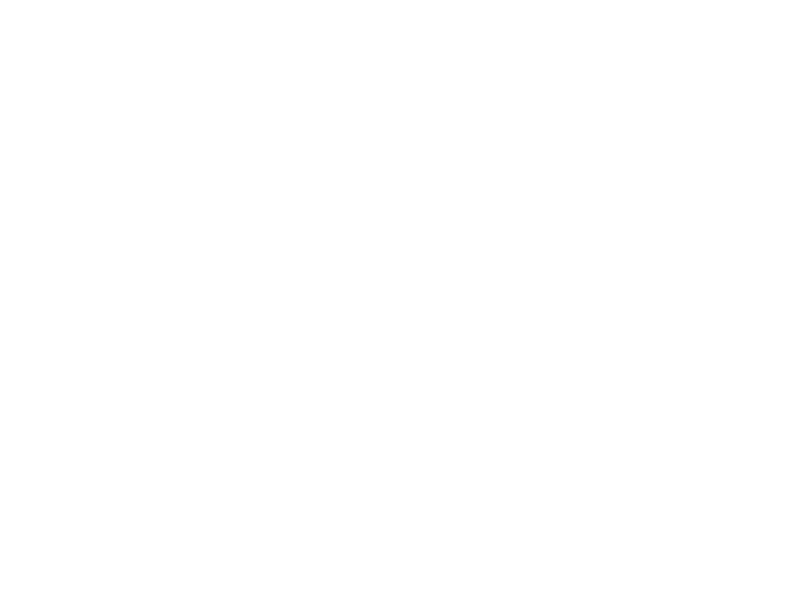
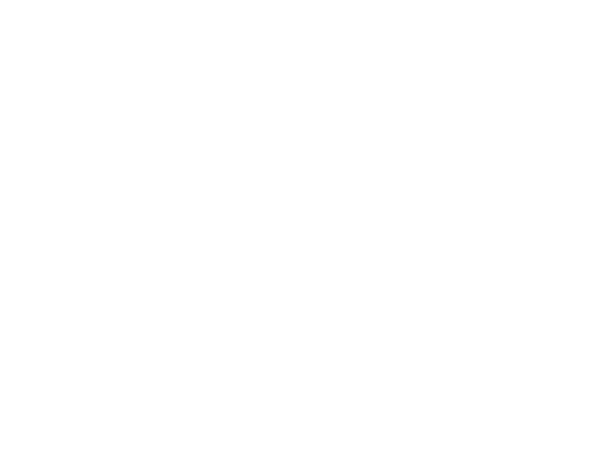
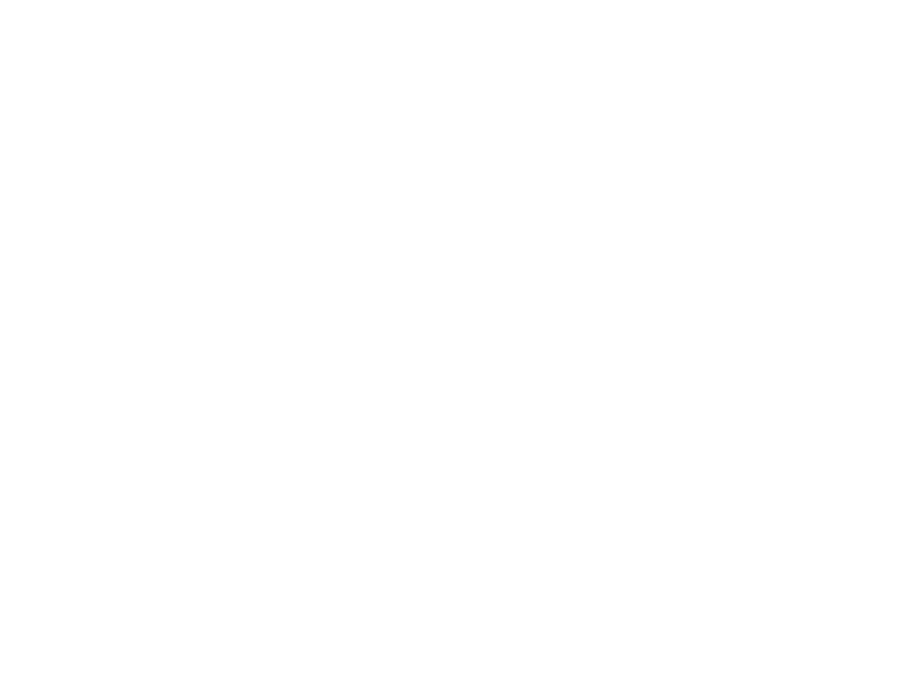
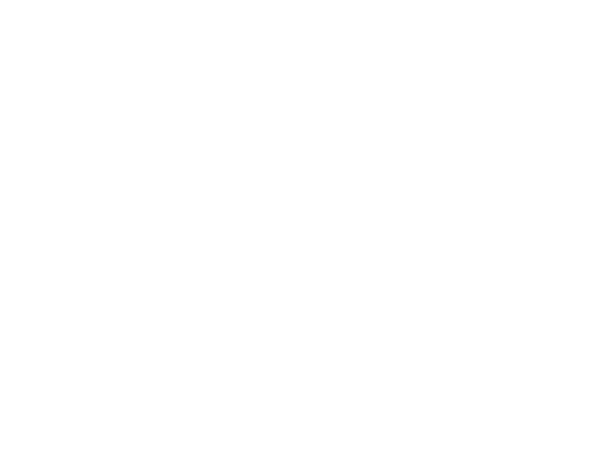

<div align="center">

# A/B Test Design & Sizing

**How many users do you need, how long should you wait, and when can you trust the result?**


</div>

---

## The Short Version

An e-commerce team wants to test a redesigned checkout page. They expect conversion to rise from **10% to 12%**. Before using any real traffic, this project works out how big the test must be, then runs thousands of simulated experiments to check whether the testing method can be trusted.

| Question | Answer |
|---|---|
| How many users are needed? | **3,839 per group** (7,678 total) |
| How long should the test run? | Traffic fills the sample in 1.54 days, but run **at least 7 full days** to cover weekdays and weekends |
| Does the standard fixed-sample test work as designed? | Yes, within simulation noise. **4.82%** false positives (target 5%) and **79.99%** power (target 80%) |
| What if the team keeps checking and stops at the first "win"? | False positives rise to **17.36%**, about 3.6 times higher |
| Can a simulation-calibrated OBF-shaped method control the false positives? | It brings the false-positive rate to **4.88%** in independent simulation, but power is **77.94%**, below the 80% target |

> [!IMPORTANT]
> **Takeaway:** Decide the sample size and the stopping rule before launch. Do not stop a test early just because the p-value dips below 0.05.

<details>
<summary><b>Plain-English glossary</b></summary>

| Term | Meaning |
|---|---|
| False positive | The test says "the new page is better" when it is not |
| Power | The chance the test catches a real improvement of the planned size |
| MDE (minimum detectable effect) | The smallest lift the test is built to detect |
| Peeking | Checking results again and again, and stopping when they look good |
| Sequential boundary | A stricter threshold at each interim check, so repeated looks stay honest |

</details>

---

## Contents

1. [Results at a Glance](#results-at-a-glance)
2. [Business Problem](#business-problem)
3. [Experiment Design](#experiment-design)
4. [Sample Size and Duration](#sample-size-and-duration)
5. [Synthetic Data](#synthetic-data)
6. [Fixed-Sample Hypothesis Testing](#fixed-sample-hypothesis-testing)
7. [The Peeking Problem](#the-peeking-problem)
8. [OBF-Shaped Sequential Boundaries](#obf-shaped-sequential-boundaries)
9. [Key Findings](#key-findings)
10. [Recommendations](#recommendations)
11. [Project Structure](#project-structure)
12. [How to Run](#how-to-run)
13. [Limitations](#limitations)

---

## Results at a Glance

### Experiment setup

| Item | Value |
|---|---:|
| Control conversion rate | 10% |
| Variant conversion rate | 12% |
| Absolute MDE | 2 percentage points |
| Relative lift | 20% |
| Significance level (α) | 5% |
| Target power | 80% |
| Required users per group | 3,839 |
| Total required users | 7,678 |
| Daily eligible traffic (both groups combined) | 5,000 |
| Minimum operational run time | 7 days |

### Simulation results

| Method / scenario | Simulations | Est. false-positive rate | Est. power |
|---|---:|---:|---:|
| Fixed-sample test | 10,000 per scenario | 4.82% | 79.99% |
| Naive peeking (8 checks) | 5,000 under the null | 17.36% | n/a |
| Classical OBF-shaped boundary | As implemented in notebook | 6.58% | 81.42% |
| Simulation-calibrated OBF-shaped boundary | 20,000 per evaluation scenario | 4.88% | 77.94% |

### Method comparison

The dashed line marks the 5% target. Naive peeking is well above it, while the simulation-calibrated OBF-shaped method is close to it in the independent evaluation.

<p align="center">
  
  <br><sub><i>False-positive rate by testing method. Dashed line: 5% target.</i></sub>
</p>

The dashed line marks the 80% target. The calibrated OBF-shaped method controls false positives, but its estimated power falls short of the target.

<p align="center">
  
  <br><sub><i>Estimated power by testing method. Dashed line: 80% target.</i></sub>
</p>

### Simulation uncertainty

Monte Carlo 95% intervals for the fixed-sample and peeking results:

| Metric | 95% interval |
|---|---:|
| Fixed-sample false-positive rate | 4.40% – 5.24% |
| Fixed-sample power | 79.21% – 80.77% |
| Naive peeking false-positive rate | 16.31% – 18.41% |

> [!NOTE]
> These intervals show how much the simulated rates move from run to run. They are not confidence intervals for a treatment effect in a real experiment.

**Reading the table:** the fixed-sample results sit on the design targets within simulation noise. Power is 79.99%, a hair under the 80% target. Naive repeated testing inflates false positives badly. The calibrated OBF-shaped procedure holds false positives near 5% in its independent evaluation, but its power is under the 80% target for this setup.

---

## Business Problem

| Role | Description |
|---|---|
| **Control** | Current checkout page |
| **Variant** | New checkout page |
| **Primary metric** | Conversion rate |

A higher conversion rate in the variant group does not prove the new page is better. Random variation can produce a gap even when both pages perform the same.

Before launch, the team has to settle five things:

- How many users are required?
- How long should the experiment run?
- How will the two conversion rates be compared?
- How often will the test be checked?
- What stopping rule keeps repeated checking from producing false wins?

## Experiment Design

| Parameter | Value |
|---|---:|
| Control conversion rate | 0.10 |
| Variant conversion rate | 0.12 |
| Significance level (α) | 0.05 |
| Target power (1 − β) | 0.80 |
| Absolute MDE | 0.02 |
| Daily eligible traffic | 5,000 users |
| Test | Two-sided, two-proportion test |
| Traffic allocation | 50% / 50% |

### Hypotheses

- **Null (H₀):** control and variant conversion rates are equal.
- **Alternative (H₁):** the conversion rates are different.

$$
H_0: p_c = p_v \qquad H_1: p_c \ne p_v
$$

### Minimum Detectable Effect

The MDE is the smallest effect this experiment is built to detect at the chosen significance level and power. Whether a lift that small is worth shipping is a separate business call.

$$
\text{MDE} = 0.12 - 0.10 = 0.02
$$

- **Absolute lift:** 2 percentage points
- **Relative lift:** 20% over the 10% baseline

## Sample Size and Duration

The notebook uses a two-proportion sample-size calculation (normal approximation) with a two-sided 5% significance level and 80% power.

### Smaller lifts need far more users

| Absolute MDE | Users per group | Total users | Days at 5,000 users/day |
|---|---:|---:|---:|
| 1 percentage point | 14,749 | 29,498 | 5.90 |
| **2 percentage points (selected)** | **3,839** | **7,678** | **1.54** |
| 3 percentage points | 1,772 | 3,544 | 0.71 |

Halving the MDE from 2 points to 1 point nearly quadruples the required sample, from 7,678 to 29,498 users.

### Selected design

$$
N_{\text{total}} = 3{,}839 \times 2 = 7{,}678
$$

$$
\text{Traffic duration} = \frac{7{,}678}{5{,}000} \approx 1.54 \text{ days}
$$

The 1.54-day figure only says how fast traffic fills the sample. It is not the recommended calendar duration.

### Why run for at least 7 days?

A test that covers only part of a week can over- or under-represent weekday and weekend behaviour. The recommendation is to run **7 complete days** and also reach the planned sample size before deciding.

At 5,000 eligible users a day, seven days gives about 35,000 users. There are two ways to use that:

- Send roughly **22% of traffic** to the experiment, which reaches the planned 7,678 users over the week; or
- Send all eligible traffic for seven days, accepting a larger-than-needed sample and wider exposure to the variant.

Pick the allocation and the stopping rule before launch, not after seeing interim results.

## Synthetic Data

The notebook generates conversions as Bernoulli trials using the group probabilities below.

| Group | Users | Generation probability |
|---|---:|---:|
| Control | 3,839 | 10% |
| Variant | 3,839 | 12% |
| **Total** | **7,678** | n/a |

Output file: `data/simulated_ab_test_run.csv`

In the notebook's current run, the observed results were:

| Group | Users | Conversions | Observed conversion rate |
|---|---:|---:|---:|
| Control | 3,839 | 390 | 10.16% |
| Variant | 3,839 | 429 | 11.17% |

Observed rates will not match the generation probabilities exactly. That gap is ordinary sampling noise, and it is the reason an experiment needs a statistical test and not a side-by-side comparison of percentages.

## Fixed-Sample Hypothesis Testing

One simulated experiment says little about how reliable a testing method is. The notebook repeats the test many times under two scenarios.

### Scenario A: no real difference

Both groups convert at 10%. A well-behaved test should reject the null about 5% of the time.

| Metric | Result |
|---|---:|
| Simulations | 10,000 |
| Significance threshold | 0.05 |
| Estimated false-positive rate (Type I error) | **4.82%** |

### Scenario B: a real 2-point lift

Control converts at 10% and the variant at 12%.

| Metric | Result |
|---|---:|
| Simulations | 10,000 |
| True difference | 2 percentage points |
| Estimated power | **79.99%** |

At 80% power, a test still misses a real effect in roughly 1 of every 5 repeated experiments.

> [!NOTE]
> The estimated power is 79.99%, marginally below the 80% target. The gap is far smaller than the simulation error, so the design is treated as meeting its target. It is reported as measured, not rounded up.

### P-value distributions

The chart compares p-values from the no-effect scenario (10% vs 10%) with the scenario containing a 2-point lift (10% vs 12%). The dashed line marks the 0.05 threshold. With no effect, p-values spread evenly between 0 and 1, so about 5% fall below 0.05. With a real lift, they bunch up near zero.

<p align="center">
  
  <br><sub><i>Simulated p-values, no effect vs 2-point lift. Dashed line: 0.05 threshold.</i></sub>
</p>

## The Peeking Problem

Peeking means checking the p-value again and again and stopping as soon as it falls below 0.05, even though the test was designed for one final look. Every extra check is another chance to get a false win, so the overall false-positive rate climbs.

### Setup and result

| Parameter | Value |
|---|---:|
| Control conversion probability | 10% |
| Variant conversion probability (no effect) | 10% |
| Simulations | 5,000 |
| Significance checks per test | 8 |
| Threshold at each check | 0.05 |
| Estimated false-positive rate | **17.36%** |

| Approach | Estimated false-positive rate |
|---|---:|
| One planned final check | 4.82% |
| Eight unadjusted checks, stop at first significant result | 17.36% |

Peeking raised the false-positive rate from 4.82% to 17.36%, about 3.6 times higher.

> [!WARNING]
> This is the share of simulated **no-effect** experiments that wrongly declared a winner. It is not the share of all observed winning tests that are false.

If interim monitoring is required, use a sequential procedure (boundaries or alpha spending) built to control the overall Type I error rate.

## OBF-Shaped Sequential Boundaries

The notebook also explores an **O'Brien-Fleming-shaped (OBF-shaped) boundary** across eight interim looks. Early looks need very strong evidence to stop, and the bar relaxes toward the planned final sample. Two versions are compared:

1. A classical OBF-shaped boundary
2. A simulation-calibrated OBF-shaped boundary

| Method | Est. false-positive rate | Est. power |
|---|---:|---:|
| Classical OBF-shaped | 6.58% | 81.42% |
| Simulation-calibrated OBF-shaped | 4.88% | 77.94% |

**Calibration:** 100,000 simulations gave a boundary constant of **2.0814**, with a calibration false-positive rate of 5.00%.

**Independent evaluation:** the calibrated boundary was then tested on fresh simulations, 20,000 per scenario.

- False-positive rate (10% vs 10%): **4.88%**
- Power (10% vs 12%): **77.94%**

The separate evaluation matters. A boundary tuned on one set of simulations will always look good on that same set, so the honest number is the one from the fresh run.

> [!NOTE]
> **Methodology:** this is an OBF-shaped, simulation-calibrated exploration, not a fully validated standard O'Brien-Fleming group-sequential design. Estimated power is below the 80% target in this evaluation. The per-look nominal alpha values in the notebook are the two-sided normal-tail probabilities implied by each boundary. They are not separate, independent alpha allocations.

### Calibrated boundary

The chart shows the simulation-calibrated OBF-shaped stopping boundary across the planned interim looks. Early looks need much stronger evidence to stop than later ones.

<p align="center">
  
  <br><sub><i>Calibrated OBF-shaped stopping boundary across eight interim looks.</i></sub>
</p>

## Key Findings

1. **Smaller effects need much larger samples.** Detecting a 1-point lift takes about 3.8 times the users needed for a 2-point lift.
2. **The fixed-sample design lands on target within simulation noise.** False positives are 4.82%. Power is 79.99%, which is 0.01 points under the 80% target. With 10,000 simulations (about ±0.8 points), that cannot be told apart from 80%.
3. **Naive peeking inflates false positives.** Eight unadjusted checks gave 17.36% in the no-effect scenario.
4. **Sequential boundaries need validation.** The classical OBF-shaped boundary gave 6.58% false positives. Calibration brought that to 4.88% in independent testing, at the cost of power (77.94%).
5. **Calendar time matters.** Hitting the sample-size target does not guarantee that weekday and weekend patterns are covered.
6. **Simulation tests the method, not just the data.** With known ground truth, false-positive rates and power can be measured directly.

## Recommendations

For a real experiment:

- Write down the primary metric, hypothesis, MDE, sample size, traffic allocation, analysis method and stopping rule **before launch**.
- Run for at least seven complete days and reach the planned sample size.
- Check that the 50/50 split held, and look into any sample-ratio mismatch before reading results.
- Report the estimated effect with a confidence interval, not only a p-value.
- Do not apply an ordinary 0.05 test repeatedly and stop at the first significant result.
- If interim decisions are needed, choose and validate a sequential procedure before the test starts.

A reusable planning document is included as [`test-plan-template.md`](test-plan-template.md).

## Project Structure

```text
ab-test-design-sizing/
├── data/
│   └── simulated_ab_test_run.csv   # generated by the notebook
├── figures/
│   ├── p_value_distributions.png
│   ├── calibrated_obf_boundaries.png
│   ├── false_positive_rate_comparison.png
│   └── statistical_power_comparison.png
├── ab_test_sizing.ipynb            # full analysis
├── test-plan-template.md           # reusable pre-launch test plan
├── requirements.txt
├── README.md
└── .gitignore
```

The CSV is created when the notebook runs. It is kept in the repo so readers can inspect the example data without running anything.

## How to Run

**Requirements:** Python 3.12 or newer, Git, and Jupyter Notebook (or VS Code with the Jupyter extension).

**1. Get the files**

```bash
git clone https://github.com/satyam-katara/ab-test-design-sizing.git
cd ab-test-design-sizing
```

**2. Create a virtual environment (optional)**

<details>
<summary>Windows PowerShell</summary>

```powershell
python -m venv .venv
.\.venv\Scripts\Activate.ps1
```

</details>

<details>
<summary>macOS / Linux</summary>

```bash
python -m venv .venv
source .venv/bin/activate
```

</details>

**3. Install dependencies**

```bash
python -m pip install -r requirements.txt
```

**4. Launch Jupyter**

```bash
jupyter notebook
```

Open `ab_test_sizing.ipynb` and run the cells from top to bottom. The notebook creates the `data/` and `figures/` folders, writes `simulated_ab_test_run.csv` into `data/`, and saves the four chart images into `figures/`.

## Limitations

- **Illustrative scenario.** The checkout example and traffic numbers are synthetic. No real users or production page were tested.
- **Synthetic outcomes.** Bernoulli conversions do not capture real user behaviour, dependence between users, or repeat visits.
- **Approximate sample-size formula.** It uses a normal approximation. Other methods may suit very small samples or rare conversion events better.
- **Monte Carlo noise.** Simulation estimates change with the random draw. The reported intervals describe that noise, not a treatment effect.
- **Sequential method scope.** The OBF-shaped calibration is an educational exercise, not a replacement for a fully specified and independently validated group-sequential design.
- **Real-world factors not modelled.** Seasonality, holidays, marketing campaigns, sample-ratio mismatch, tracking errors and repeat users.
- **Seven days is a practical minimum, not a guarantee.** Low-traffic products or unusual calendar effects may need longer.

---

<div align="center">

**A/B Test Design & Sizing**

*Plan the test first. Trust the result second.*

Built by Katara · [GitHub](https://github.com/satyam-katara)

</div>